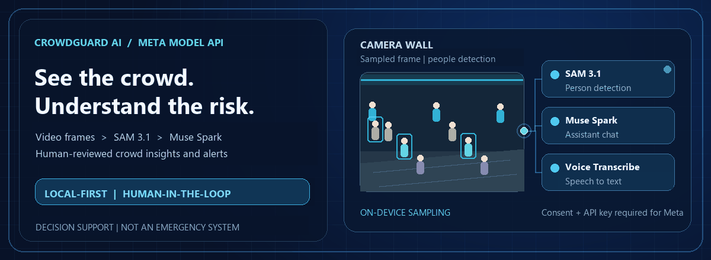
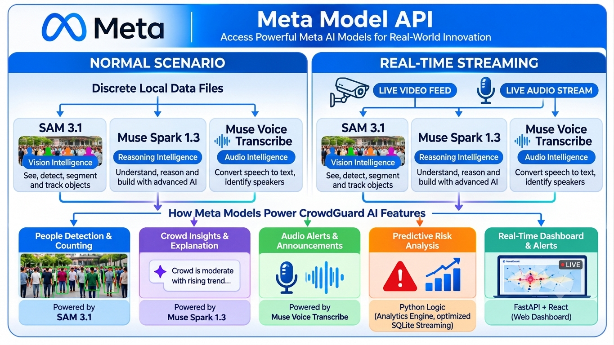

<h1 align="center">CrowdGuard AI</h1>

<p align="center">
  
</p>

<p align="center"><b>Crowd-safety decision support for Durga Puja pandals</b><br>
Camera snapshots · people counting · crowd insights · an AI assistant</p>

## Watch CrowdGuard AI

1. [Demo Link](https://youtu.be/rkOlrEYQvE8)
2. [Watch how to install CrowdGuard AI](https://youtu.be/UBskITcGP8o)


<p align="center">
  <a href="docs/INSTALL.md">Install and control CrowdGuard</a> ·
  <a href="docs/assistant-tools.md">Assistant tools and permissions</a> ·
  <a href="docs/meta-integration.md">Meta integration details</a>
</p>

---

## 1. How CrowdGuard AI builds on Meta products

CrowdGuard combines Meta's vision, language and speech models with a local FastAPI service and a React control room.
The browser samples a frame from a selected video; SAM 3.1 can detect people in that still image. Muse Spark explains
recorded app data and answers staff questions through permission-checked tools. Muse Voice Transcribe turns an
on-demand microphone recording into editable text. Deterministic Python logic—not a language model—calculates
forecasts and risk values.



> **Implementation note:** the illustration is a product overview, not a claim that this build uses real-time Meta
> streaming. CrowdGuard currently sends interval-based JPEG snapshots and push-to-talk audio clips. The SAM 3.1
> detector is opt-in; without it, the built-in synthetic demo stays local and is never sent to a paid model.

## 2. Meta features: implementation and code

### A. Send a video frame to Meta SAM 3.1

The browser does **not** upload a whole video to Meta. It takes a JPEG snapshot from the playing video and sends it to
CrowdGuard's authenticated API. The backend forwards that frame to SAM 3.1 only when the real detector is enabled.

**Implementation:** [frontend/src/components/CameraTile.tsx](frontend/src/components/CameraTile.tsx) captures the
frame; [frontend/src/api/client.ts](frontend/src/api/client.ts) sends it to
`POST /api/vision/cameras/{camera_id}/analyze`; [backend/api/vision_routes.py](backend/api/vision_routes.py) runs the
camera workflow; [backend/vision/detector.py](backend/vision/detector.py) calls Meta.

```tsx
off.toBlob((frame) => {
  if (!frame) return;
  api.visionAnalyze(cam.id, frame);
}, 'image/jpeg', 0.7);
```

The backend encodes the JPEG as a data URL and sends it as an `input_image` alongside the `"person"` prompt:

```python
data_url = "data:image/jpeg;base64," + base64.b64encode(jpeg).decode("ascii")
body = {
    "model": SAM_MODEL,
    "stream": True,
    "metadata": {"include_confidence": "true"},
    "input": [{"type": "message", "role": "user", "content": [
        {"type": "input_text", "text": "person"},
        {"type": "input_image", "image_url": data_url},
    ]}],
}
```

### B. Chat with Meta Muse Spark

The assistant sends the signed-in user's question to `POST /api/assistant/chat`. The backend gives Muse Spark
permission-scoped tool definitions; tools read CrowdGuard data, and any proposed change waits for the user's explicit
Yes/No/Cancel confirmation.

**Implementation:** [frontend/src/pages/Assistant.tsx](frontend/src/pages/Assistant.tsx) handles chat;
[backend/assistant/routes.py](backend/assistant/routes.py) exposes the API;
[backend/assistant/orchestrator.py](backend/assistant/orchestrator.py) runs tool calls;
[backend/integrations/meta_adapter.py](backend/integrations/meta_adapter.py) calls the Responses API.

```python
body = {
    "model": self.model,
    "instructions": instructions,
    "input": input_items,
    "max_output_tokens": self._max_output_tokens,
    "store": False,
    "reasoning": {"effort": self._effort},
    "include": ["reasoning.encrypted_content"],
}
if tools:
    body["tools"] = tools
    body["tool_choice"] = "auto"
```

### C. Convert speech to text

The user records a short clip with **Speak**. The browser converts it to mono, 16-bit, 16 kHz WAV, sends it to
`POST /api/assistant/transcribe`, and shows the transcript for review before it is sent as a chat message.

**Implementation:** [frontend/src/pages/Assistant.tsx](frontend/src/pages/Assistant.tsx) converts and submits the
recording; [frontend/src/audio/wav.ts](frontend/src/audio/wav.ts) encodes WAV;
[backend/assistant/routes.py](backend/assistant/routes.py) validates the clip;
[backend/assistant/transcribe.py](backend/assistant/transcribe.py) calls Muse Voice Transcribe.

```tsx
const wav = await toWav16k(clip);
const result = await api.assistantTranscribe(wav, language);
setDraft(result.transcript); // The user can review or edit it before sending.
```

## 3. Models used

| Purpose | Model or component | What it does | Configuration |
|---|---|---|---|
| People detection and counting | **Meta SAM 3.1** (`sam-3.1`) | Detects people in one sampled JPEG frame and returns boxes/counts. | Opt in with `CROWDGUARD_DETECTOR=sam31` and a Meta Model API key; about $0.0025 per image. |
| Explanations and assistant chat | **Meta Muse Spark** (default `muse-spark-1.3`) | Explains recorded values and answers questions using server-side tools; it does not calculate counts or forecasts. | Opt in with `CROWDGUARD_PROVIDER=meta` and a Meta Model API key. |
| Speech transcription | **Meta Muse Voice Transcribe** (`muse-voice-transcribe-1.0`) | Transcribes a user-recorded WAV clip; the transcript is editable before chat. | Opt in with `CROWDGUARD_VOICE=meta`; audio is not stored by the app. |
| Forecasting and risk | Deterministic Python | Produces rule-based forecasts and risk values from app data. | Runs locally; no language model call. |

The app can run offline with its local template provider and simulated detector. SAM 3.1 frames and voice recordings
leave the computer only when the corresponding Meta features are configured and used. This is an experimental
decision-support tool, not an emergency-response system or a safety guarantee.
